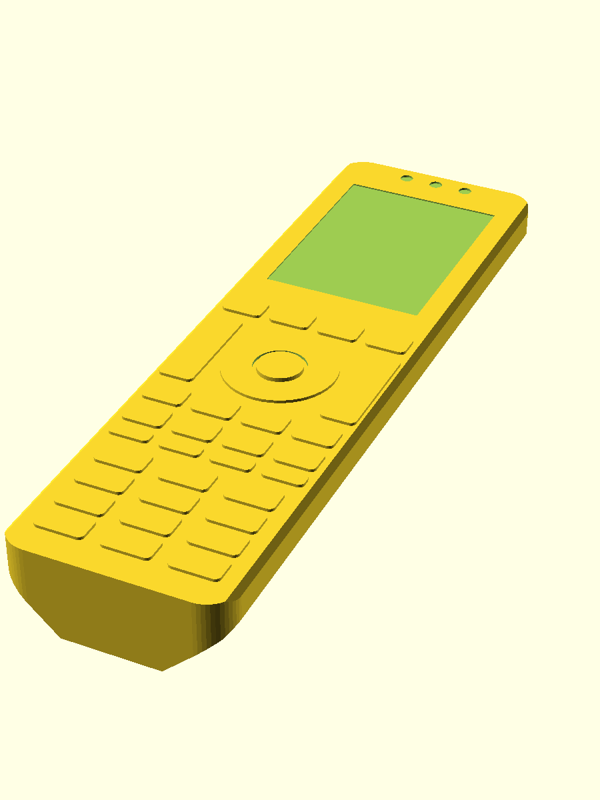

# FullZapette

An open, 3D-printable universal remote in the spirit of the Logitech Harmony:
real buttons, a colour touchscreen, an IR blaster and a native Home Assistant link.

**Status:** design phase — nothing is built yet.

- [Design document](docs/DESIGN.md) — requirements, architecture, part choices, key layout, power budget, open questions.
- [Mock-ups](mockups/) — 1:1 printable front layouts (SVG) and solid ergonomic dummies (STL), generated by `mockups/gen_mockup.py`.

At a glance (draft v0.2):

| | |
|---|---|
| Size | ≈ 197 × 58 mm, trapezoid section 13–27 mm thick |
| Screen | 2.8" IPS, 240 × 320, capacitive touch |
| Brain | ESP32-S3 (Wi-Fi + BLE) |
| Control | IR send + learn, Home Assistant (WebSocket), BLE HID |
| Keys | Backlit hard keys (25 or 37, being settled on mock-ups) |
| Wake | Pick-up (accelerometer), any key |
| Battery | One 18650, ≈ 1.5–9 weeks (estimated), USB-C + pogo-pin cradle |
| Enclosure | Fully FDM-printable |

