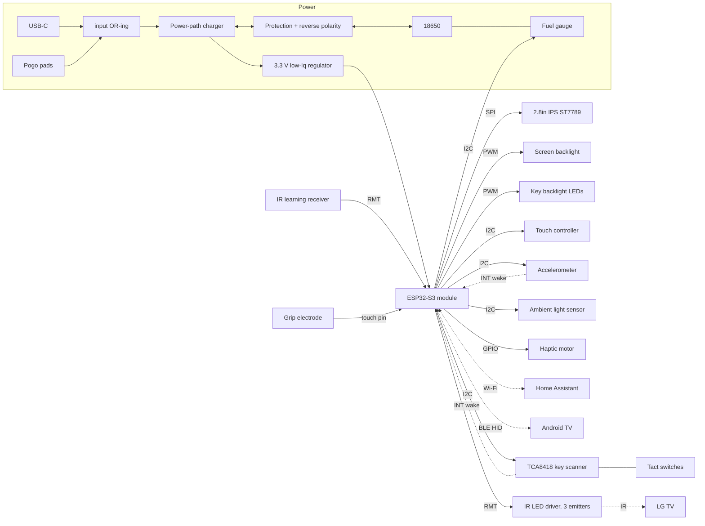

# FullZapette — design document

Status: **draft v0.2** — nothing is built or measured yet; figures marked *(est.)* are estimates to be
confirmed on a prototype. Changes since v0.1: 2.8" screen, 18650 cell with a trapezoid body, backlit keys,
day-one targets defined, first layout mock-ups, Lovelace question answered (§12).

## 1. Goal

An open, 3D-printable universal remote in the spirit of the Logitech Harmony: one TV-remote-shaped
device with real buttons, a colour screen, an IR blaster, and a native Home Assistant (HA) link.

| Requirement | How this design answers it |
|---|---|
| TV-remote shape, medium size | Candy-bar, ≈ 197 × 58 mm, trapezoid section 13–27 mm thick |
| Colour screen, good viewing angles, backlit | 2.8" IPS TFT, 240 × 320, capacitive touch, auto-dimmed backlight |
| IR port | 3 × 940 nm emitters at the nose + a learning receiver |
| Home Assistant: control + small dashboards | Wi-Fi, device-initiated HA WebSocket API, native LVGL pages mirrored from an HA dashboard |
| Multi-day battery | One standard 18650 (≈ 3400 mAh), ≈ 1.5–9 weeks depending on use *(est.)* |
| Wake on pickup | Accelerometer interrupt (primary) + capacitive grip electrode (keep-awake / false-wake filter) |
| Charging cradle with pogo pins | Yes, passive cradle, plus USB-C on the remote |
| All plastic parts 3D printable | 2 shells + keycaps + cradle, FDM, sized for a Bambu Lab X1C |
| Buttons below the screen | Backlit hard keys; exact set to be settled on mock-ups (§8) |

**Day-one use case**

| Target | Link | Notes |
|---|---|---|
| Android TV box | **Bluetooth LE HID** (the remote pairs like a Bluetooth remote/keyboard) | D-pad, OK, Back, Home, transport, works without Wi-Fi. Fallback: HA's Android TV Remote integration over Wi-Fi |
| LG TV | **IR** | Volume ±, mute, power off (LG uses the NEC protocol; a discrete "off" code exists — to be verified on the set) |
| Lights | **Home Assistant** | Touchscreen page with toggles / dimmers / scenes |

So the first activity, "Watch TV", maps navigation keys to BLE, volume and power to IR, and the screen to lights.

Non-goals for v1: microphone / voice (no Google Assistant button), RF 433 MHz, Zigbee/Thread, a real web browser.

## 2. Prior art

- **Logitech Harmony Elite / 950** — the ergonomic reference: touchscreen on top, hard keys below,
  inclined charging cradle, "activities" as the core concept. Discontinued, cloud-dependent.
- **[OMOTE](https://github.com/CoretechR/OMOTE)** — open-source ESP32 remote: 2.8" capacitive touchscreen,
  IR, LIS3DH wake-on-pickup, 2000 mAh Li-Po, 3D-printed case, LVGL + MQTT + BLE keyboard. It proves this
  general architecture works. FullZapette differs in: a fuller, backlit key set, a standard 18650, a pogo-pin
  cradle with a docked mode, and a first-class HA link (WebSocket, mirrored dashboards).
- **openHASP / ESPHome-LVGL** — native HA touch panels on ESP32; the model for our dashboard widgets.
- **Unfolded Circle Remote 3, Sofabaton X1S** — commercial, closed, need a hub/dock for the smart-home side.

## 3. Key decisions

| # | Decision | Choice | Status | Main reason |
|---|---|---|---|---|
| D1 | MCU / radio | **ESP32-S3** module (Wi-Fi + BLE, native USB) | proposed | Talks to HA directly, BLE HID for Android TV, enough CPU/PSRAM for LVGL, µA sleep. See §12 for why not a Linux board |
| D2 | Display | **2.8" IPS, 240 × 320, ST7789, SPI, capacitive touch** | **agreed** | More dashboard room; sets body width to 58 mm |
| D3 | Keys | **SMD tact switches + printed keycaps, TCA8418 I²C scanner** | proposed | µA standby, one wake interrupt, buffers the key that caused the wake — first press never lost |
| D4 | Key backlight | **White LEDs under translucent keycaps with opaque tops, PWM, on only in the dark** | **agreed (required)** | See §5.3 |
| D5 | Wake | **Accelerometer motion interrupt** + any key; grip electrode as add-on | proposed | µA-level, no user action |
| D6 | Sleep | **Light sleep** first minutes idle, then **deep sleep** | proposed | Instant resume, negligible long-term drain |
| D7 | HA link | **HA WebSocket API, opened by the remote**, long-lived token | proposed | Connects the moment it wakes; no broker |
| D8 | Battery | **One 18650, in spring contacts** | **agreed** | Most standard cell there is; ≈ 70 % more capacity than the flat Li-Po; drives the trapezoid body |
| D9 | Charging | **USB-C + 2 pogo contacts**, power-path charger | proposed | Cradle adds drop-and-forget and a docked display mode |
| D10 | Firmware | **Custom, ESP-IDF + LVGL** | **agreed** | Control over sleep/wake latency |

## 4. System architecture



## 5. Electronics

### 5.1 Core
- **ESP32-S3-WROOM-1** (or S3-MINI-1), ≥ 8 MB flash, 2–8 MB PSRAM. Native USB: charge, flash and console on one port.
- Wi-Fi and BLE share one radio; the S3 time-slices them. BLE HID + an idle WebSocket is a light load, but
  coexistence is on the M0 test list.
- Antenna at the **nose** (the hand covers the lower half), overhanging the display's metal back-plate.

### 5.2 Display and touch
- 2.8" IPS 240 × 320, ST7789-family, SPI; module outline ≈ 50 × 69.2 mm, active area ≈ 43.2 × 57.6 mm.
- Capacitive touch with cover glass (FT6336 / CST-series over I²C, with interrupt). The glass is the front surface.
- Backlight PWM-dimmed; an ambient light sensor (VEML7700 class) sets screen *and* key brightness.
- **Sourcing caveat:** outline, thickness, FPC position and driver IC vary between vendors of "the same" panel.
  Freeze one exact part number and get its drawing before real CAD or PCB work.

### 5.3 Keys and key backlight
- SMD tact switches, low force (≈ 160 gf), soft-click type. Count per the layout chosen in §8.
- **TCA8418** I²C keypad scanner: debounce, event FIFO, one interrupt to an RTC-capable GPIO for wake-up.
- **Backlight:**
  - One small white LED on the PCB beside each key (or per pair of keys), ≈ 1 mA each, all on one PWM
    MOSFET (optionally 2 zones: navigation / numpad). ≈ 15–30 mA total when lit *(est.)*.
  - Keycaps printed in **translucent (natural) PETG with a black top skin**; the legend is the gap in the black
    skin, so the legend itself glows. With an AMS this is a two-colour first layer; without one, a filament
    swap after the first layers gives the same result with slightly recessed legends.
  - The top shell is opaque black with ≥ 1.6 mm walls; a printed black web between keys blocks light bleed.
  - Lit only when the remote is awake **and** the light sensor says it is dark; fades out with the screen.

### 5.4 Infrared
- **Transmit:** 3 × 940 nm emitters — one narrow straight ahead, two wide splayed ≈ 30° — MOSFET-switched from
  the battery rail with a bulk capacitor, modulated by the RMT peripheral, ≈ 300–500 mA peak per LED.
- **Receive / learn:** carrier-pass-through learning receiver (TSMP58000-type), powered only in learning mode.
- Emitter domes sit in recessed holes in the nose (dark FDM plastic is unpredictable in IR).

### 5.5 Sensors and feedback
- **Accelerometer:** LIS2DH12 (or BMA400), low-power motion-threshold interrupt, a few µA. Also "face-down = sleep".
- **Grip electrode:** copper pour along the PCB edges / foil in the back shell on an ESP32-S3 touch pin.
- **Haptic:** small coin vibration motor for touchscreen feedback and "find me".

### 5.6 Power
- **Cell:** one **18650**, 3000–3500 mAh, held in PCB leaf-spring contacts inside a printed cradle in the back
  shell. The bay accepts 65 mm unprotected flat-tops up to 70 mm protected button-tops.
- Because the user inserts the cell: **reverse-polarity protection** and an on-board protection circuit
  (over-discharge, over-current) are mandatory, whatever cell is used.
- **Charger:** power-path type (BQ24074 class), ≈ 0.5–1 A (≈ 4–7 h full), NTC against the cell.
- **Inputs:** USB-C (5.1 kΩ CC resistors, 5 V) and pogo pads, OR-ed so exposed pads are never live from USB.
- **Fuel gauge:** MAX17048 (I²C, no sense resistor).
- **3.3 V rail:** low-quiescent regulator ≥ 600 mA (RT9080 / XC6220 class); at Li-ion voltages a linear
  regulator is already ≈ 88 % efficient.
- A load switch cuts IR receiver, light sensor and haptic driver in sleep.

### 5.7 PCB
- One long main board ≈ 52 × 185 mm, 1.6 mm, 4 layers, doubling as the structural spine.
- Front: switches, key LEDs, display connector. Back: module, power, battery contacts, pogo pads.

## 6. Power budget and battery life *(est.)*

| State | Current | Notes |
|---|---|---|
| Active, screen on, Wi-Fi + BLE connected | ≈ 130 mA | backlight ≈ 50 %, modem sleep, mostly idle CPU |
| Key backlight (dark room only) | +15–30 mA | |
| Light sleep (first 10 min idle) | ≈ 0.7–1 mA | chip datasheet says 240 µA; real boards measure higher |
| Deep sleep | ≈ 60 µA | chip ≈ 7 µA + always-on peripherals |
| Daily standby overhead | ≈ 10 mAh/day | blended, conservative |

With a 3400 mAh cell, ≈ 2700 mAh usable:

| Usage (screen-on time) | Daily drain | Battery life |
|---|---|---|
| Light — 15 min/day | ≈ 42 mAh | ≈ 9 weeks |
| Typical — 45 min/day | ≈ 108 mAh | ≈ 3.5 weeks |
| Heavy — 2 h/day | ≈ 270 mAh | ≈ 10 days |

A month is within reach for typical use but not guaranteed, so the cradle stays in scope. Screen-on time
dominates; the firmware levers are a short screen timeout and rejecting false wakes.

## 7. Wake and sleep behaviour

```
            motion INT / key INT / dock power
   SLEEP ───────────────────────────────────────▶ AWAKE
     ▲                                              │
     │   no grip + no input for T_idle (≈ 10 s)     │
     │   or placed face-down                        │
     └──────────────────────────────────────────────┘
   light sleep ──(10 min without wake)──▶ deep sleep
```

- **On wake:** the last page is drawn from cached state at once; Wi-Fi + HA socket and the BLE link to the
  Android TV come back in the background (target ≈ 1–2 s — to be measured in M0).
- **IR never waits for a radio.** The key that woke the remote is read from the TCA8418 FIFO and sent
  immediately. BLE and HA actions are queued until their link is up, then sent in order; they are dropped
  after a few seconds with a visible error.
- **False-wake filter:** a motion wake with no grip, key or touch within ≈ 5 s goes straight back to sleep.
- **Stay-awake:** while a hand is on the grip electrode, the idle timer is extended (dim 20 s, off 60 s).
- **Docked:** powered, so radios stay connected; dim clock / now-playing page; HA can reach the remote.

## 8. Key layout — to be settled on mock-ups

The key set is **not frozen**: it gets decided by handling mock-ups. Two candidates are generated from one
script, [`mockups/gen_mockup.py`](../mockups/gen_mockup.py):

| Variant | Size | Keys | Content |
|---|---|---|---|
| `full` | 58 × 197 mm | 37 | everything below |
| `short` | 58 × 159 mm | 25 | same without the numpad (numpad on the touchscreen) |

Top to bottom under the screen:

1. Power · Back · Home · Activity
2. D-pad ring + OK in the centre, **Volume rocker on the left, Channel rocker on the right**
3. Menu · Mute · Last · Guide
4. Rewind · Play/Pause · Fast-forward · Stop
5. Red · Green · Yellow · Blue (slim)
6. Numpad 1–9, -/--, 0, Enter (`full` only)

Putting the rockers beside the D-pad instead of below it keeps the whole navigation block under the thumb
and saves ≈ 25 mm of length compared with v0.1.

Mock-up files:

- [`mockups/front-layout.svg`](../mockups/front-layout.svg) — both variants at 1:1. Print on paper at 100 %
  (check the 50 mm bar), cut out, tape on a block.
- `mockups/mockup_full.stl`, `mockups/mockup_short.stl` — solid dummies with the trapezoid body, key bumps
  and screen recess, to judge size, grip and thumb reach. Print on the back, supports under the nose; both
  fit the X1C bed straight.
- To try another layout: edit `build()` in the script, run it, then `openscad -o mockup_full.stl mockup_full.scad`.

Every key is remappable per activity; legends show the default role only.

## 9. Mechanics

- **Envelope (`full`):** 197 × 58 mm. Cross-section is a **trapezoid**: 58 mm wide front face, 8 mm vertical
  side edges, then ≈ 50° chamfers down to a 26 mm flat on the back. The 18650 lies along the spine under the
  lower half, where the palm is; thickness runs from ≈ 13 mm at the nose to ≈ 27 mm at the belly.
- **Stack-up at the belly (≈ 27.5 mm):** top shell 1.6 · keycap + switch 3.5 · PCB 1.6 · cell 18.6 + 0.6
  clearance · back shell 1.6.
- **Printed parts (X1C, 0.4 mm nozzle, PETG or ASA):**
  1. Top shell — face-down on a textured plate; screen ledge and key openings need no supports.
  2. Back shell — the 50° chamfers print without supports; perimeter lip + M2 screws into heat-set inserts.
     Removing it gives access to the cell (a tool-less battery door can come later).
  3. Keycaps — translucent body, black top skin (§5.3); D-pad as one rocking ring + separate OK; Vol/Ch rockers.
  4. Light-blocking web between top shell and PCB (may be part of the top shell).
  5. Cradle body + base.
- **Screen mounting:** cover glass in a recessed ledge on thin double-sided foam tape (also the dust seal).
- **Non-printed hardware:** screws, inserts, battery contacts, pogo pins, optional magnets, optional cradle weight.
- Everything fits the 256 mm bed flat; diagonal placement leaves room for a longer body if a mock-up asks for it.

## 10. Charging cradle

- Inclined rest (≈ 25°), screen readable when docked; a V-groove matching the trapezoid back self-centres the remote.
- **2 spring pogo pins** (5 V, GND) in the cradle mate with gold pads on the back flat near the tail.
  Dock detection = voltage present.
- Cradle electronics: USB-C receptacle (5.1 kΩ CC resistors) → resettable fuse → pogo pins. No active parts.
- Remote side: reverse-polarity and short protection on the pads; pads are dead when undocked.

## 11. Firmware

- **Stack:** ESP-IDF, LVGL 9, RMT-based IR (NEC, RC5/RC6, SIRC, Samsung, Panasonic, raw/learned), NimBLE HID
  (consumer control + keyboard), HA WebSocket client.
- **Model:** *devices* (things with commands: IR codes, BLE keys, HA service calls) and *activities*
  (start/stop sequence + key map + touchscreen page), as on a Harmony.
- **Home Assistant:**
  - Subscribes only to the entities shown on the configured pages.
  - Reports back: battery %, docked/charging, current activity, and key events (any hard key can trigger an HA automation).
  - Dashboards: see §12.
- **Configuration:** JSON on flash, edited through a small web UI served by the remote while docked/awake.
- **Updates:** OTA over Wi-Fi; USB as fallback.

## 12. Why not real Lovelace cards — and what we do instead

**Why not.** A Lovelace card is a web component: JavaScript + CSS that only runs inside a full browser engine
(Chromium/WebKit). The HA frontend needs hundreds of MB of RAM and a Linux- or Android-class processor.
An ESP32-S3 has 8 MB of RAM and no operating system that could host a browser — it is not short by a
factor of two but of a hundred, and no faster microcontroller (ESP32-P4, STM32H7…) closes that gap, because
the missing piece is the browser stack, not MHz.

**The alternative to the ESP32** is therefore a small Linux computer (Raspberry Pi Zero 2 W / Compute Module
class) running a kiosk browser. That gives real Lovelace, at this price:

| | ESP32-S3 (this design) | Linux board + browser |
|---|---|---|
| Idle / standby power | ≈ 0.06–1 mA asleep | ≈ 100+ mA, no practical µA suspend on Pi-class boards |
| Battery life on one 18650 | weeks | roughly a day, or hours with the screen on |
| Wake to usable | instant screen, ≈ 1–2 s to HA | tens of seconds from off; must stay on to be responsive |
| Real Lovelace + custom cards | no | yes |
| Complexity | one module | essentially building a small phone |

It breaks two core requirements (multi-day battery, instant wake on pickup), so it is rejected. If real
Lovelace in the hand is the priority, an old phone in a printed shell does that job better than anything we can build.

**What we do instead**, in order of priority:

1. **Mirror a dedicated HA dashboard natively.** The remote reads the configuration of one HA dashboard
   (built with the normal HA editor) over the WebSocket and renders the standard card types as native LVGL
   widgets: button, tile, entities, light, media-control, sensor, gauge, thermostat. You author in HA; the
   remote shows a fast, native equivalent. Custom (HACS) cards and exotic styling are not supported.
2. **Escape hatch — server-rendered page (later).** For anything else, HA renders the real card to an image
   with a headless browser (the technique used for e-ink dashboards) and the remote displays it, sending
   taps back as coordinates. Real cards, but ≈ 1 s latency, no animation, Wi-Fi only.

## 13. Indicative BOM *(est., single unit)*

| Item | ≈ € |
|---|---|
| ESP32-S3 module | 4 |
| 2.8" IPS + capacitive touch | 10–14 |
| 18650 cell + contacts | 8 |
| PCB (per unit, batch of 5) + assembly share | 10–18 |
| TCA8418, accelerometer, fuel gauge, charger, protection, regulator, light sensor | 9 |
| Tact switches + key LEDs | 5 |
| IR emitters + receiver + driver | 2 |
| USB-C, connectors, passives, haptic | 5 |
| Pogo pins, magnets, screws, inserts, cradle USB-C | 5 |
| Filament | 3 |
| **Total** | **≈ 60–75** |

## 14. Risks

| Risk | Mitigation |
|---|---|
| Wake-to-usable latency feels slow (Wi-Fi / BLE reconnect) | IR independent of radios; queued keys; cached UI; measure in M0 |
| Android TV does not wake from standby over BLE HID, or reconnects slowly | Test on the actual box in M0; fallbacks: HA Android TV Remote integration, HDMI-CEC via the LG TV's IR power |
| False wakes on a sofa drain the battery | Grip filter, tunable motion threshold, short timeout |
| Printed keys feel cheap, rattle, or leak light | Prototype one key cluster with LEDs before the PCB; TPU keymat as plan B |
| Backlit legends unreadable (too thin for a 0.4 mm nozzle) | Legend stroke ≥ 0.5 mm, large glyphs; try a 0.2 mm nozzle for keycaps |
| Display variant mismatch | Freeze one exact part number before CAD |
| Antenna detuned by display frame / hand / cell | Antenna at the nose with keep-out; check RSSI on the first board |
| User inserts the cell backwards / uses a poor cell | Reverse-polarity protection, on-board protection circuit, keyed bay markings |
| Body too thick or too long in the hand | Mock-ups before anything else (M1) |

## 15. Milestones

- **M0 — Bench proof (dev kit):** ESP32-S3 + display + accelerometer + IR LED. Measure sleep currents and
  wake-to-HA time; pair as BLE HID with the Android TV; LG volume/power over IR; one light toggled through HA.
- **M1 — Mock-ups:** print the dummies, settle size, key set and pitch. Then one real key cluster with
  switches, LEDs and translucent caps to validate feel and backlight.
- **M2 — PCB rev A.**
- **M3 — Firmware v0:** "Watch TV" activity end-to-end, IR learn, mirrored HA page, sleep/wake state machine.
- **M4 — Cradle + docked mode.**
- **M5 — Rev B** and build guide.

## 16. Open questions

- **Q1 — Layout:** after handling the mock-ups: `full` or `short`? Keys to add or drop? Is 27 mm at the belly acceptable?
- **Q2 — AMS:** is the X1C fitted with an AMS (decides how keycap legends are made)?
- **Q3 — Android TV box model** (Chromecast, Shield, Freebox, TV-integrated…): affects BLE wake behaviour and key codes.
- **Q4 — Cell access:** is unscrewing the back shell to change the cell acceptable for v1, or is a tool-less door wanted?
