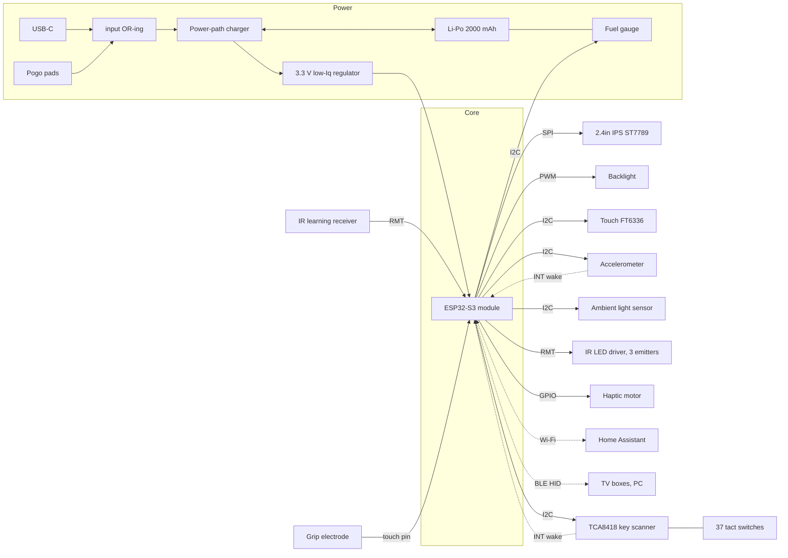

# FullZapette — design document

Status: **draft v0.1** — a first complete proposal to react to. Nothing here is built or measured yet;
figures marked *(est.)* are estimates to be confirmed on a prototype.

## 1. Goal

An open, 3D-printable universal remote in the spirit of the Logitech Harmony: one TV-remote-shaped
device with real buttons, a colour screen, an IR blaster, and a native Home Assistant (HA) link.

| Requirement | How this design answers it |
|---|---|
| TV-remote shape, medium size | Candy-bar, ≈ 200 × 50 × 20 mm, one-handed |
| Colour screen, good viewing angles, backlit | 2.4" IPS TFT, 240 × 320, capacitive touch, PWM backlight |
| IR port | 3 × 940 nm emitters at the nose + a learning receiver |
| Home Assistant: control + small dashboards | Wi-Fi, device-initiated HA WebSocket API, native LVGL pages bound to entities |
| Multi-day battery | 2000 mAh Li-Po, ≈ 1–5 weeks depending on use *(est.)* |
| Wake on pickup | Accelerometer interrupt (primary) + capacitive grip electrode (keep-awake / false-wake filter) |
| Charging cradle with pogo pins | Yes — battery life is weeks, not months, so the cradle is part of the baseline |
| All plastic parts 3D printable | 2 shells + keycaps + cradle, FDM, no supports on visible faces |
| Buttons below the screen | 37 keys: D-pad + OK, navigation, volume/channel, transport, colour keys, numpad |

Non-goals for v1: microphone / voice, RF 433 MHz, Zigbee/Thread radio, rendering real Lovelace dashboards.

## 2. Prior art

- **Logitech Harmony Elite / 950** — the ergonomic reference: 2.4" touchscreen on top, hard keys below,
  inclined charging cradle, "activities" as the core concept. Discontinued, cloud-dependent.
- **[OMOTE](https://github.com/CoretechR/OMOTE)** — open-source ESP32 remote: 2.8" capacitive touchscreen,
  IR, LIS3DH wake-on-pickup, 2000 mAh Li-Po, 3D-printed case, LVGL + MQTT. It proves this general
  architecture works. FullZapette differs in: narrower body (2.4" screen), a numpad and fuller key set,
  a pogo-pin cradle with a docked mode, and a first-class HA link (WebSocket, dashboards) instead of MQTT only.
- **Unfolded Circle Remote 3, Sofabaton X1S** — commercial, closed, need a hub/dock for the smart-home side.

## 3. Key decisions

| # | Decision | Choice | Main reason | Alternatives considered |
|---|---|---|---|---|
| D1 | MCU / radio | **ESP32-S3** module (Wi-Fi + BLE, native USB) | Talks to HA directly, enough CPU/PSRAM for a smooth LVGL UI, BLE HID as a bonus, huge ecosystem | ESP32-C6 (lower power, weaker graphics); nRF52/54 (months of battery, but needs a BLE→HA bridge) |
| D2 | Display | **2.4" IPS, 240 × 320, ST7789, SPI, capacitive touch (FT6336)** | Same size as the Harmony Elite; lets the body stay 50 mm wide; cheap and multi-sourced | 2.8" (body grows to ≈ 57 mm); AMOLED (better blacks, pricier, burn-in, harder to source bare) |
| D3 | Keys | **SMD tact switches + printed keycaps, scanned by a TCA8418 over I²C** | Controller sleeps at µA level, wakes the MCU with one interrupt, and buffers the key that caused the wake — the first press is never lost | Direct GPIO matrix (13 pins, first press at risk); silicone keymat (not printable) |
| D4 | Wake | **Accelerometer motion interrupt**, plus any key; grip electrode as a cheap add-on | µA-level, no user action; grip keeps the screen on while held still | Capacitive-only (higher sleep current, sensitive to print/assembly tolerances) |
| D5 | Sleep strategy | **Light sleep** for the first minutes idle, then **deep sleep** | Light sleep resumes instantly with state intact; deep sleep keeps long-term drain negligible | Staying on Wi-Fi with modem sleep (mA-level, kills standby) |
| D6 | HA link | **HA WebSocket API, opened by the remote** with a long-lived token | The remote connects the moment it wakes; no broker needed; subscribe to states + call services on one socket | ESPHome native API (HA must reconnect to the device after each wake); MQTT (needs a broker) |
| D7 | Battery | **Single Li-Po pouch, 103450, ≈ 2000 mAh** | Fits the handle, thin, ubiquitous | 18650 (replaceable, 3000+ mAh, but ≈ 26 mm thick belly) |
| D8 | Charging | **USB-C on the remote + 2 pogo contacts**, power-path charger | USB-C alone is enough to live with; cradle adds the drop-and-forget habit and a docked display mode | Qi (thicker, hotter, costlier) |
| D9 | Firmware | **Custom, ESP-IDF + LVGL** | Full control over sleep/wake latency, which decides whether the device feels good | ESPHome + LVGL (fastest to a demo — reasonable for board bring-up, weak on sleep) |

## 4. System architecture



## 5. Electronics

### 5.1 Core
- **ESP32-S3-WROOM-1** (or the smaller S3-MINI-1), ≥ 8 MB flash, 2–8 MB PSRAM.
- Native USB on the S3: charging, flashing and serial console through the one USB-C port, no bridge chip.
- Antenna at the **nose** of the remote (the hand covers the lower half). It must overhang the
  display's metal back-plate and the battery; this sets the top bezel height (≈ 8–10 mm).

### 5.2 Display and touch
- 2.4" IPS 240 × 320, ST7789-family, 4-wire SPI; module outline ≈ 42.7 × 60.3 mm, active area ≈ 36.7 × 49.0 mm.
- Capacitive touch with cover glass (FT6336 over I²C, with interrupt). The cover glass is the front surface.
- Backlight: PWM-dimmed via a MOSFET; an ambient light sensor (VEML7700 or similar) sets brightness automatically.
- **Sourcing caveat:** outline, thickness (≈ 2.2–4.3 mm), FPC position and even the driver IC differ between
  vendors of "the same" panel. Pick one exact part and get its drawing before any CAD or PCB work.

### 5.3 Keys
- 37 SMD tact switches, low force (≈ 160 gf), ideally the "silent" soft-click type.
- **TCA8418** I²C keypad scanner (up to 80 keys): debouncing, 10-event FIFO, single interrupt line to an
  RTC-capable GPIO for wake-up.
- Key backlighting is **not** in v1 (see §11).

### 5.4 Infrared
- **Transmit:** 3 × 940 nm emitters — one narrow-beam straight ahead, two wide-angle splayed ≈ 30° —
  switched by an N-MOSFET, fed from the battery rail with a local bulk capacitor, modulated by the ESP32 RMT
  peripheral. Target ≈ 300–500 mA peak per LED for across-the-room range.
- **Receive / learn:** a carrier-pass-through learning receiver (TSMP58000-type) so codes with any carrier
  frequency can be captured; its supply is switched on only in learning mode.
- Dark FDM plastics are unpredictable in IR, so the emitter domes sit in recessed holes in the nose
  rather than behind a printed window.

### 5.5 Sensors and feedback
- **Accelerometer:** LIS2DH12 (or BMA400), low-power mode with motion-threshold interrupt, a few µA.
  Also used for "placed face-down = sleep now" and lift detection while docked.
- **Grip electrode:** a copper pour on the PCB edge / foil inside the back shell, wired to an ESP32-S3 touch
  pin. Costs one pin and no parts. Only sampled while awake.
- **Haptic:** small coin vibration motor for touchscreen feedback and "find me" buzz.

### 5.6 Power
- **Cell:** 103450 Li-Po with protection circuit, ≈ 2000 mAh, JST connector.
- **Charger:** power-path type (BQ24074 class), ≈ 500 mA charge (≈ 4–5 h full). Power path matters because the
  remote can run a docked display mode indefinitely without disturbing charge termination.
- **Inputs:** USB-C (5.1 kΩ CC resistors, 5 V only) and pogo pads, OR-ed through ideal-diode/Schottky paths so
  the exposed pads are never live when USB is plugged in.
- **Fuel gauge:** MAX17048 (I²C, no sense resistor) for an honest percentage on screen and in HA.
- **3.3 V rail:** a low-quiescent regulator rated ≥ 600 mA (RT9080 / XC6220 class). At Li-ion voltages a
  linear regulator is already ≈ 88 % efficient, so a buck converter buys little; a buck-boost is only worth
  it if we want to drain the cell below ≈ 3.4 V.
- A load switch cuts the IR receiver, light sensor and haptic driver in sleep.

### 5.7 PCB
- One long main board ≈ 44 × 185 mm, 1.6 mm, doubling as the structural spine.
- Front: tact switches, display connector. Back: module, power, battery connector, pogo pads (or a small daughter board).
- 4 layers preferred (antenna/USB/power integrity); JLCPCB-assemblable parts wherever possible.

## 6. Power budget and battery life *(est.)*

| State | Current | Notes |
|---|---|---|
| Active, screen on, Wi-Fi connected | ≈ 120 mA | backlight ≈ 50 %, modem sleep, mostly idle CPU |
| IR burst | +100–300 mA average during a frame | tens of ms per key press — negligible energy |
| Light sleep (first 10 min idle) | ≈ 0.7–1 mA | datasheet says 240 µA for the chip; real boards measure higher |
| Deep sleep | ≈ 60 µA | chip ≈ 7 µA + accelerometer, key scanner, gauge, regulator, display in sleep |
| Daily standby overhead | ≈ 10 mAh/day | blended light/deep sleep, conservative |

With 2000 mAh nominal, 1600 mAh usable:

| Usage (screen-on time) | Daily drain | Battery life |
|---|---|---|
| Light — 15 min/day | ≈ 40 mAh | ≈ 5–6 weeks |
| Typical — 45 min/day | ≈ 100 mAh | ≈ 2 weeks |
| Heavy — 2 h/day | ≈ 250 mAh | ≈ 6 days |

Conclusion: "multiple days" is met with margin, "a month" only for light use — so the **cradle is in scope**.
Screen-on time dominates everything; the biggest firmware levers are a short screen timeout and not waking
on false motion.

## 7. Wake and sleep behaviour

```
            motion INT / key INT / dock power
   SLEEP ───────────────────────────────────────▶ AWAKE
     ▲                                              │
     │   no grip + no input for T_idle (≈ 10 s)     │
     │   or placed face-down                        │
     └──────────────────────────────────────────────┘
   light sleep ──(10 min without wake)──▶ deep sleep
```

- **Wake sources:** accelerometer motion interrupt, any key (via TCA8418), touch-panel interrupt (optional),
  power arriving on USB/pogo.
- **On wake:** screen shows the last page from cached state immediately; Wi-Fi + HA socket come up in the
  background (target ≈ 1–2 s from light sleep with cached channel/BSSID/IP — to be measured).
- **IR and BLE keys never wait for Wi-Fi.** The key that woke the remote is read from the TCA8418 FIFO and
  sent at once. HA-bound actions are queued until the socket is up and dropped after a few seconds with a
  visible error.
- **False-wake filter:** a motion wake with no grip, key or touch within ≈ 5 s goes straight back to sleep,
  without starting Wi-Fi if grip is absent at wake time.
- **Stay-awake:** while the grip electrode reports a hand, the idle timer is extended (dim after 20 s, off after 60 s).
- **Docked:** powered, so Wi-Fi stays connected; screen shows a dim clock / now-playing page, and HA can
  reach the remote (e.g. "find me" buzz, pushed config).

## 8. Key layout

37 keys, top to bottom. Row pitch ≈ 9–10 mm, so the key field is ≈ 125 mm long.

```
        ┌──────────────────────────┐
        │  ● ● ●  IR emitters      │  nose (antenna behind bezel)
        │ ┌──────────────────────┐ │
        │ │                      │ │
        │ │   2.4" IPS touch     │ │
        │ │   240 × 320          │ │
        │ │                      │ │
        │ └──────────────────────┘ │
        │  [POWER]      [ACTIVITY] │  all-off · activity list
        │                          │
        │  [BACK]   ▲    [HOME]    │
        │       ◀  [OK]  ▶         │  D-pad ring + OK, 4 corner keys
        │  [MENU]   ▼    [GUIDE]   │
        │                          │
        │  [V+]   [MUTE]   [CH+]   │  Vol and Ch as rockers
        │  [V−]   [LAST]   [CH−]   │
        │                          │
        │  [⏪]  [⏯]  [⏩]  [⏹]   │  transport
        │  [RED] [GRN] [YEL] [BLU] │  colour keys (slim)
        │                          │
        │   [1]    [2]    [3]      │
        │   [4]    [5]    [6]      │
        │   [7]    [8]    [9]      │
        │  [-/--]  [0]   [ENTER]   │
        └──────────────────────────┘
```

| Group | Keys | Count |
|---|---|---|
| System | Power (activity off), Activity | 2 |
| Navigation | Up, Down, Left, Right, OK, Back, Home, Menu, Guide | 9 |
| Audio / channel | Vol+, Vol−, Mute, Ch+, Ch−, Last | 6 |
| Transport | Rewind, Play/Pause, Fast-forward, Stop | 4 |
| Colour | Red, Green, Yellow, Blue | 4 |
| Numpad | 0–9, -/--, Enter | 12 |

Every key is remappable per activity; legends describe the default role only. Rarely used functions
(Record, Subtitles, Input, Prev/Next…) live on the touchscreen page of the current activity.

## 9. Mechanics

- **Envelope:** ≈ 200 × 50 × 20 mm, rounded back, slight belly (≈ 22 mm) over the battery under the numpad so
  the centre of mass sits in the palm; index-finger notch behind the D-pad. Target mass ≈ 130–150 g.
- **Stack-up (≈ 20 mm):** top shell 1.6 · keycap + switch 3.5 · PCB 1.6 · components / battery 10–11 · back shell 1.6.
- **Printed parts (FDM, 0.4 mm nozzle, PETG or ASA):**
  1. Top shell — printed face-down on a textured plate; screen ledge and key openings need no supports.
  2. Back shell — printed inside-up; closes with a perimeter lip + 4–6 M2 screws into heat-set inserts.
  3. Keycaps — rigid, flanged, captured between top shell and PCB; D-pad as one rocking ring + separate OK;
     Vol and Ch as rockers. Legends as a two-colour first layer (multi-material printer) or debossed and paint-filled.
  4. Cradle body + base.
- **Screen mounting:** cover glass sits in a recessed ledge on thin double-sided foam tape; the tape is also the dust seal.
- **Non-printed hardware:** screws, heat-set inserts, pogo pins, optional alignment magnets, optional steel
  weight in the cradle base.
- **Design rules:** 1.6 mm walls, 0.2 mm clearance per side around keycaps, no overhang beyond 45° on visible
  faces, fits a 220 mm bed diagonally if needed (200 mm body on a 180 mm bed does not fit — see open question Q6).

## 10. Charging cradle

- Inclined rest (≈ 25° from horizontal) so the screen is readable when docked and gravity gives contact pressure.
- **2 spring pogo pins** (5 V, GND) in the cradle mate with gold pads on the underside near the tail of the
  remote. Dock detection = voltage present; no third pin needed.
- Optional magnet pair for self-alignment; pads symmetric or keyed pocket so the remote cannot seat backwards.
- Cradle electronics: USB-C receptacle breakout (5.1 kΩ CC resistors) → resettable fuse → pogo pins. No active parts.
- Remote side: reverse-polarity and short protection on the pads; pads are dead when undocked.

## 11. Firmware

- **Stack:** ESP-IDF, LVGL 9, RMT-based IR encode/decode (NEC, RC5/RC6, Sony SIRC, Samsung, Panasonic, raw/learned), NimBLE for HID.
- **Model:** *devices* (things with commands: IR codes, BLE keys, HA service calls) and *activities*
  ("Watch TV" = power-on sequence + key map + touchscreen page), as on a Harmony.
- **Home Assistant:**
  - WebSocket API client with a long-lived access token; subscribes only to the entities used by the configured pages.
  - Dashboards are **native LVGL pages** built from a small widget set — toggle tile, slider (light/volume),
    media-player card, sensor value, scene/script button, climate setpoint. Real Lovelace cards cannot run here.
  - The remote reports back to HA: battery %, docked/charging, current activity, and key events
    (so any hard key can trigger an HA automation).
- **Configuration:** JSON on flash (devices, activities, pages, learned codes), edited through a small web UI
  served by the remote while docked/awake; later, optionally a HA custom integration to push it.
- **Updates:** OTA over Wi-Fi; USB as fallback.
- **Later, not v1:** key backlighting, HA custom integration, sharing learned-code databases, voice.

## 12. Indicative BOM *(est., single unit)*

| Item | ≈ € |
|---|---|
| ESP32-S3 module | 4 |
| 2.4" IPS + capacitive touch | 8–12 |
| Li-Po 2000 mAh | 6 |
| PCB (per unit, batch of 5) + assembly share | 8–15 |
| TCA8418, accelerometer, fuel gauge, charger, regulator, light sensor | 8 |
| 37 tact switches | 3 |
| IR emitters + receiver + driver | 2 |
| USB-C, connectors, passives, haptic | 5 |
| Pogo pins, magnets, screws, inserts, cradle USB-C | 5 |
| Filament | 2 |
| **Total** | **≈ 50–60** |

## 13. Risks

| Risk | Mitigation |
|---|---|
| Wake-to-usable latency feels slow (Wi-Fi reconnect) | IR/BLE independent of Wi-Fi; cached UI; measure early on a dev board (milestone M0) |
| False wakes on a sofa drain the battery | Grip electrode filter, tunable motion threshold, short timeout |
| Printed keys feel cheap or rattle | Prototype one key cluster first; soft-click switches; tight flange tolerances; TPU keymat as plan B |
| Display variant mismatch | Freeze one exact part number before CAD |
| Antenna detuned by display frame / hand / battery | Antenna at the nose with keep-out; check RSSI on the first board |
| IR range too short | Three emitters, high pulse current from the battery rail, narrow + wide optics |
| Li-Po safety in a printed case | Protected cell, charger thermal limit, PETG/ASA rather than PLA, no charge below 0 °C / above 45 °C (NTC) |

## 14. Milestones

- **M0 — Bench proof (dev kit, no custom hardware):** ESP32-S3 dev board + display + accelerometer + IR LED.
  Measure sleep currents, wake-to-screen and wake-to-HA times; send IR to a real TV; one LVGL page bound to HA.
- **M1 — Ergonomic mock-up:** print the shell and keycaps with a dummy PCB; settle size, key pitch, key feel.
- **M2 — PCB rev A:** schematic, layout, assembly; bring-up of every peripheral.
- **M3 — Firmware v0:** activities, IR learn/send, HA pages, sleep/wake state machine.
- **M4 — Cradle + docked mode.**
- **M5 — Rev B** with everything learnt; publish build guide.

## 15. Open questions

- **Q1 — Screen size:** 2.4" (50 mm body, recommended) or 2.8" (≈ 57 mm body, more dashboard room)?
- **Q2 — Key set:** is the 37-key layout right? Candidates to add: Record, Prev/Next track, Input, Subtitles;
  candidates to drop: colour keys, Last.
- **Q3 — Firmware route:** custom ESP-IDF firmware (recommended) or ESPHome-based?
- **Q4 — Which devices must it control on day one?** (TV brand, box, amplifier, consoles — decides IR-only vs BLE HID priority.)
- **Q5 — Battery:** flat Li-Po (recommended) or user-replaceable 18650 with a thicker body?
- **Q6 — Printer constraints:** bed size and single- vs multi-material? A 200 mm shell needs a ≥ 220 mm bed
  (or diagonal placement on a 180 mm one); two-colour legends need a multi-material setup.
- **Q7 — Key backlighting:** acceptable to leave for a later revision?
